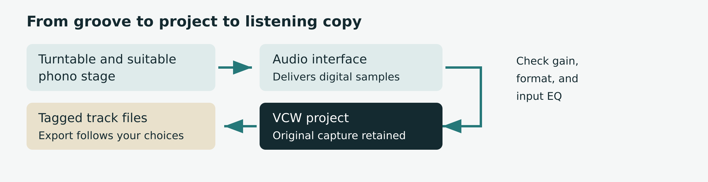
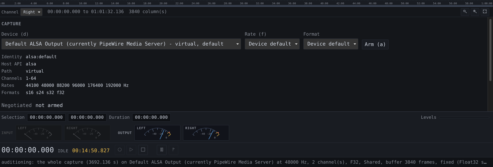
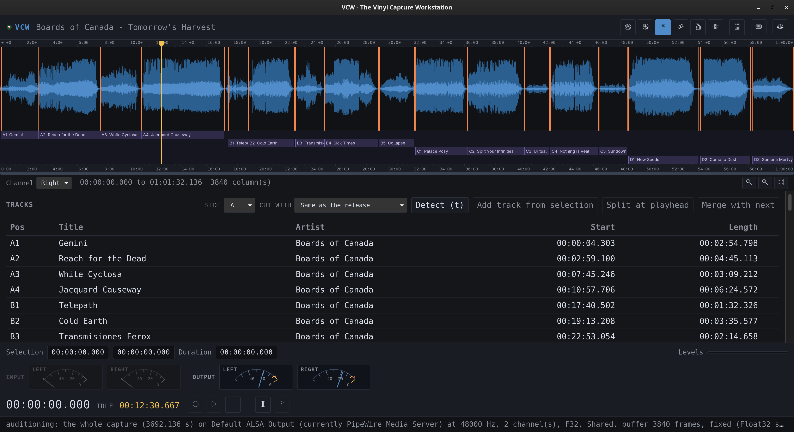
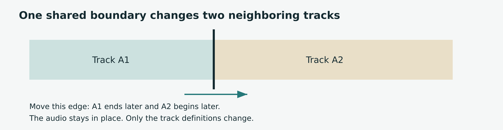
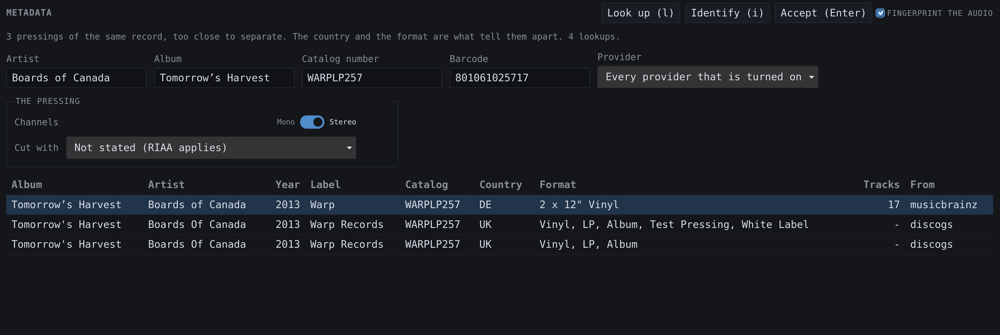
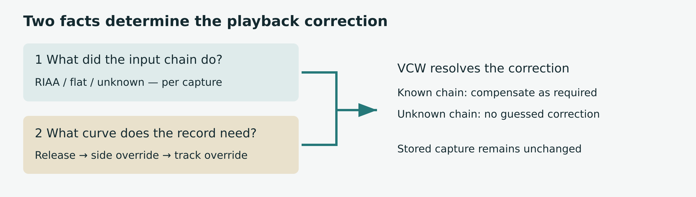
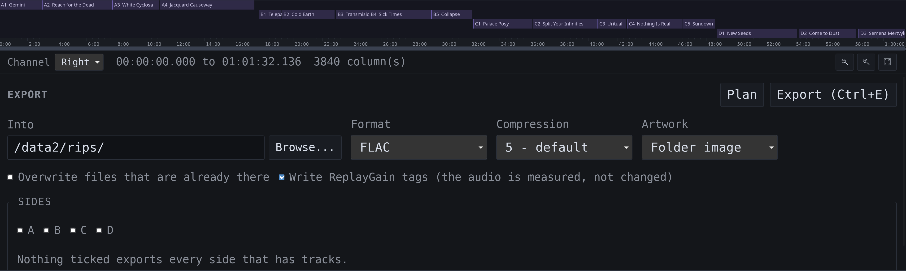

# VCW User Guide

*From a physical record to digital tagged tracks*

A practical guide for listeners, audiophiles, archivists, and people who would rather script the whole thing.

VCW captures your records, keeps the original audio in a project, helps you find and name the tracks, and exports files ready for your music library. This guide takes you through that journey without assuming you already speak fluent audio engineer.

Start with a short test recording. Once you have heard it, checked its levels, and exported a track, you are ready for a complete album. The rare pressing can wait five minutes. It has potentially already waited several decades.

**The promise to remember.** Your capture is the source. Track boundaries, names, and playback choices sit alongside it. An export is a new set of files made from those decisions.

**About this edition.** Prepared October 20, 2026, against VCW version 0.3.8. VCW is currently alpha software. Installer availability and hardware validation depend on the build and platform. Start with the release notes for your installed version.

**Inside this package.** An editable Word guide, this Markdown source, original explanatory graphics in SVG and PNG, and clearly labeled screenshot placeholders. The screenshot brief explains exactly what to capture and where it belongs.

© 2026 Stue Hunter. Independent VCW documentation.

## 1 Choose your route

You do not have to read this guide from front to back. There won’t be a test, and nobody is grading your record collection.

**Weekend vinyl warrior.** Read Chapters 2 through 7, then 9 and 10. You will connect the equipment, record both sides, review the tracks, and make tagged listening files. Leave advanced EQ and the command line until you need them.

**Audiophile.** Add Chapters 8 and 11. These explain what VCW can establish about the digital signal, what changes it, and why a lossless file is not automatically an untouched one.

**Archivist or collection manager.** Read the whole capture workflow plus Chapters 8, 11, 12, 13, and 16. Pay particular attention to input-chain provenance, pressing identification, backups, migrations, and the distinction between a preservation source and a listening derivative. VCW is a tool in your preservation process; it does not define your institution's policy.

**Automation enthusiast or developer.** Read Chapters 14 and 15 after one successful manual transfer. The CLI operates on the same project model as the desktop application. The repository also documents the Rust API and SQLite schema.

**How the highlighted notes work.** Bold lead-ins identify advice for a particular audience. “Remember” marks an idea worth keeping. “Watch out” marks something that can cost audio, time, or a carefully organized afternoon. These are reading aids, not separate workflows.

### Find the task

Chapters 2–3: connect and configure. Chapters 4–5: record and navigate. Chapters 6–7: arrange and identify. Chapters 8–11: EQ, export, formats, and fidelity. Chapters 12–13: import and protect projects. Chapters 14–15: CLI and remote control. Chapters 16–18: troubleshooting, shortcuts, and glossary.

## 2 Build a sensible signal chain

Your computer needs a recording-level signal. A cartridge generally needs a suitable phono stage before it reaches an ordinary audio interface's line input. A turntable with built-in phono amplification or a USB output may already provide some of this chain. Check the equipment documentation before connecting it.



*Signal chain*

1. Connect the turntable through the appropriate phono stage to the interface's line inputs. If the turntable supplies line-level output, use that as directed by its manufacturer.

2. Connect the interface to the capture computer. Confirm the computer recognizes it.

3. Clean the record and check the playback setup. Software is remarkably poor at removing a fingerprint or a digestive biscuit crumb from the actual vinyl.

4. Choose a local project folder with room for the complete release and its exports.

5. Open VCW and select the real recording input. The simulated source is for testing the application, not transferring your record.

**Watch out.** Do not route an amplifier's speaker output into a line input. Do not run a line-level signal through an additional phono input. Both are the wrong connection for this job.

**Remember.** The signal may already have RIAA equalization when it reaches VCW. That fact belongs to the recording chain. The curve your particular record needs is a separate fact. Chapter 8 untangles them.

**Archivist note.** Keep a transfer log outside the project for details your catalog requires: physical item identifier, cartridge and stylus, phono stage, interface, operator, date, and known condition. Do not assume the project captures every piece of equipment provenance.

## 3 Make the first five minutes count

Install a package appropriate to your operating system from the VCW Releases page. If no suitable package is published, the repository README provides source-build instructions. Packaging targets include Linux x86\_64 and aarch64, Windows x86\_64, and Apple Silicon macOS. The published capture-path evidence is strongest on Linux x86\_64; a package existing is not the same as your interface being validated.

1. In **Library**, choose **New project** or press `n`. Choose the project location and enter the recording title, artist, and catalog number if known. Blank descriptive fields can be filled later.

2. Keep the whole release in one `.vcw` project. A double album belongs together, including all four sides.

3. In the new-project sheet, choose the record's **Equalization**. RIAA is preselected. Leave it there for an ordinary RIAA record; research historic pressings before choosing another curve.

4. In **Settings \> Audio**, set **Equalization on input** to match the phono stage: RIAA, flat, or unknown. This is not an artistic preference.

5. In **Capture** (`Ctrl+2`), choose the input device, sample rate, and sample format. Use settings your device supports. The highest number is not a substitute for a clean signal.

6. Choose **Arm** or press `a` in Capture. Play a loud passage and check the meters. Adjust the interface's input gain to leave headroom and avoid clipping. About 6 dB of peak headroom is a useful starting point, not a VCW requirement.

**Audiophile note.** Read the negotiated configuration and verification status after arming. Your requested 24/96 and the configuration actually opened are two different pieces of information.



*S01  Capture*

## 4 Record the release

Make your first capture a short test. Stop, play it back, and export it before you commit a treasured side to a workflow you have never tried.

1. With the project open and the correct input armed, start **Record** (`r`) before lowering the stylus. Leave enough lead-in to review the start later.

2. Watch the meters and the capture diagnostics. A clipping indicator deserves attention now; turning down playback later cannot restore a clipped input.

3. Let the side finish, including the final decay. Choose **Stop** (`s`) before turning the record over.

4. Review the result. The waveform becomes available after capture stops. During capture, the live meters are your visual feedback; a blank waveform is expected.

5. Record the next side into the same project. Continue through every disc, retaining a consistent recording setup wherever possible.

6. Check that the project contains the captures you expect. Review each side before putting the record away.

**Pause is not Stop.** `p` pauses or resumes a recording. Stop ends the take. Use separate takes for the sides in the normal workflow. `Space` controls audition playback, so do not use it as your recording-pause shortcut.

**Remember.** VCW commits audio during capture, in 250 ms blocks. It does not hold an entire side in memory until you press Save. An interruption can still lose an uncommitted block and device-buffered audio. Automatic commits are not a backup strategy.

**Watch out.** Do not change gain halfway through a keeper take unless the alternative is clipping. If you must intervene, note it and consider making a replacement take. There is no prestige award for saving an unusable recording.

**Archivist note.** Review verification status and overruns, underruns, dropped frames, and stream errors for every capture. Zero counters are necessary evidence of a clean transfer, but do not prove the complete analog or digital chain was correct.

## 5 Get comfortable in the window

VCW has six workspaces. The meters, transport controls, and status line remain available along the bottom. The waveform appears in Capture, Tracks, and Export once audio is available.

**Library (Ctrl+1).** Create or open projects and browse the collection. A project is a complete release, not merely the side currently on the platter.

**Capture (Ctrl+2).** Select the recording device and format, inspect the negotiated stream, and review the takes already stored in the project.

**Tracks (Ctrl+3).** Review track titles and spans, inspect boundary evidence, and adjust where tracks begin and end.

**Metadata (Ctrl+4).** Search providers, identify a release, inspect candidates, and accept the details that match your copy.

**Export (Ctrl+5).** Choose the destination and format, plan the output, and write the files.

**Settings (Ctrl+6).** Set audio, recording, detection, metadata, and export preferences, plus appearance and language choices.

### Read the waveform

Click to place the playhead. Drag across the waveform to select a region; Play then auditions that region and stops at its end. Click again to clear the selection. Drag a ruler to scroll. Wheel to zoom around the pointer; Shift-wheel pans. Shift-drag scrubs during playback.

Use `+` to zoom in, `-` to zoom out, `0` to fit the whole capture, and `z` to fit the selection or selected track or marker. Choose the channel you want to inspect.

**Remember.** Settings save without a Save button. Text fields commit when you leave them or press Enter; switches and menus commit immediately. If **Unsaved** remains visible, read the status line for the reason.



*S02  Review and assign track details*

## 6 Turn a side into tracks

Detection proposes useful boundaries. Your ears decide whether a quiet passage is the end of a track or the pianist enjoying a dramatic pause.

1. Open **Tracks** and select the capture or side you want to review.

2. Run track detection (`t` in Tracks). Inspect the proposed boundaries, confidence, and detector agreement. The boundary list can include suggestions that did not become tracks.

3. Compare the layout with the record label or sleeve. Count the tracks before asking metadata to solve the wrong puzzle.

4. Audition the beginning and end of every track, especially quiet introductions, live applause, crossfades, and continuous works.

5. Drag a boundary to move it, or select it and nudge with `Ctrl+Left` or `Ctrl+Right`. Hand-adjusted boundaries are locked against later detection.

6. Use **Add track from selection** for a missed track, **Split at playhead** for two tracks treated as one, or **Merge with next** for one track treated as two.



*Shared boundaries*

**Remember.** A boundary between adjacent tracks is the end of one and the start of the next. Moving it changes both neighbors. Tracks use start-inclusive, end-exclusive spans, so a shared edge does not duplicate a sample.

**A marker is not a track.** `m` places a boundary at the playhead. A track needs a span. Make a selection and add a track, or split an existing one.

**Watch out.** Merge has no undo. The captured audio remains intact, but the joined tracks must be split again to restore their layout. Locked internal boundaries can survive a merge; other internal boundaries may be removed. Lock useful edges before experimenting.

**Archivist note.** Detection confidence is evidence for review, not a certification. Preserve meaningful transitions instead of forcing every work to resemble a pop single with silence at each end.

## 7 Name the record you actually own

A familiar album title can have dozens of releases. The right recording and the right pressing are related questions, not identical ones.

1. Enter what you know: artist, album, catalog number, and year. The sleeve and label are useful here. So is checking that you picked up the right sleeve.

2. Open **Metadata**. Use a provider search (`l`) or **Identify** (`i`). Identify uses the project's existing facts and escalates through available lookups.

3. Review the candidate's label, catalog number, country, format, track count, and track list. Do not accept the first row merely because the artwork is familiar.

4. Accept the matching release. Acceptance writes release information, names tracks, and downloads front artwork into the project. Confirmed track titles are retained.

5. Review the resulting titles, artists, side assignments, and cover. Correct anything the source got wrong or left blank.

If the release and project have matching track counts, accepting metadata can adopt the provider's side layout without moving audio. A mismatch is reported rather than silently rearranged. Check your boundaries and the chosen pressing before trying again.

**Online setup.** MusicBrainz does not need an API key. Discogs uses `VCW_DISCOGS_TOKEN`; AcoustID uses `VCW_ACOUSTID_KEY`. `VCW_CONTACT` supplies contact information for service requests. Enable **Allow network lookups** when you want online access. Recording, local editing, and export work offline.

**Remember.** Credentials come from the application's environment, not the project. A desktop app launched from a menu may not inherit variables set only in a terminal. Settings shows whether credentials are present, never their values.

**Audiophile note.** Fingerprinting can identify a recording; it does not by itself establish your pressing. The automatic audio lookup needs tracks laid out and uses the first track of the first captured side.



*S03  Lookup / Identify*

## 8 Keep the two EQ questions separate

Question one: **What equalization did your recording chain already apply?** Set this under **Settings \> Audio \> Equalization on input**, or correct an existing capture using its **Chain** picker. Choose RIAA for an ordinary RIAA phono stage, flat for a genuinely flat transfer, and unknown when you cannot establish the answer.

Question two: **What playback characteristic does this record require?** Set the release curve when creating the project. A side can override the release, and a track can override its side. A release with no stated override resolves to RIAA.



*Equalization decision guide*

VCW includes sixteen historic characteristics, with source information. A label and an approximate year are research clues, not conclusive proof of the cutting curve. Consult the curve's documentation and evidence for the pressing before making a historical correction.

If the chain already applied RIAA and the record needs a different curve, VCW compensates for RIAA before applying the selected curve. If the chain was flat, VCW applies the required playback correction. If provenance is unknown, VCW refuses a correction that would require guessing. It can still play the stored capture without that correction.

**Remember.** EQ is applied on playback, render, and export, never written back over the captured audio. A corrected output has different samples and is not bit-perfect relative to the capture. That can be exactly the output you intended.

**Archivist note.** A later provenance correction is an assertion about the original equipment, not a new measurement. Record the evidence for it in your transfer log. Correcting RIAA digitally cannot undo analog clipping or noise already introduced upstream.

## 9 Export without surprises

An export should be the pleasingly uneventful part. The plan is how you keep it that way.

1. Finish reviewing the tracks, release details, artwork, and any EQ or mono choices.

2. Open **Export**. Choose an output directory. Desktop **Browse** uses the computer's directory chooser; remote browsing refers to the capture host, as Chapter 15 explains.

3. Choose the format. FLAC is a practical compressed lossless choice for integer captures. WAV also carries Float32. Use Chapter 10 for the exceptions that matter.

4. Check the naming template and track numbering under **Settings \> Export**. Review float narrowing settings if the project contains floating-point audio.

5. Choose **Plan**. Read every proposed filename. Check disc distinctions, side selection, the destination, and any reported conversion or refusal. With no export sides selected, all sides containing tracks are included.

6. Choose **Export** or `Ctrl+E`. Wait for completion. A full disk or disconnected destination can leave completed files from a partially finished run.

7. Play the exported files in your usual player. Check the first and last seconds, artwork, titles, order, and disc numbers. Keep the `.vcw` project as well.

**Remember.** The default template is `{album_artist}/{album}/{tracknum} - {title}`. An untitled track gets `Untitled` in the filename, while an empty title tag remains empty. Your file manager needs a name; your catalog does not need a fictional title.

**Weekend listener note.** Start with the default template and a single album. Decide how elaborate your folder system needs to be after you have something worth filing.

**Watch out.** A valid plan can still fail during writing. The planner catches unsupported combinations before encoding, but it cannot promise a removable disk will remain connected.



*S04  Export*

## 10 Choose a format on purpose

“Lossless” describes an encoding choice. It does not mean every preceding operation preserved the original samples.

| Format | Useful for | Important limits |
| --- | --- | --- |
| FLAC | Compressed lossless integer audio | Up to 32-bit integer at supported capture rates. Float input requires narrowing. |
| WAV | Uncompressed source or interchange copies | Includes Float32. Current RIFF files have an approximately 4 GiB limit per file. |
| AIFF | Uncompressed integer interchange | Integer audio; approximately 4 GiB per file. Float input requires narrowing. |
| ALAC | Lossless files for compatible Apple workflows | `.m4a`; 16, 24, or 32-bit integer, 1–8 channels. Float input requires narrowing. |
| MP3 | Broadly compatible listening copies | Lossy; mono or stereo, rates up to 48 kHz. VCW does not silently resample a 96 kHz capture for it. |
| Ogg Vorbis | Compact listening copies | Lossy; supports VCW capture rates including 192 kHz and floating-point audio. |

### Floating point needs an explicit policy

Audacity imports commonly contain Float32 audio. WAV retains it as float. FLAC, AIFF, and ALAC require integers, so conversion changes the sample representation and can introduce quantization error.

In this repository version, **Narrow to** defaults to **24**, **Dither** to **tpdf**, and **Headroom** to **0 dB**. Choose **refuse** when you want VCW to stop rather than convert float audio for an integer-only format. Choose 32-bit only for a downstream requirement. None of these choices changes the stored capture.

Dither trades correlated rounding error for a small amount of noise. Headroom attenuates before integer conversion; it can accommodate float peaks above integer full scale. Unaccommodated peaks are clamped. Review a hot float recording before export instead of assuming the container will rescue it.

**Audiophile note.** A 32-bit float value has a 24-bit significand, but float-to-integer conversion is not universally sample-exact, especially at small magnitudes. Preserve the Float32 source when exact retention matters.

## 11 Know what bit perfect means

VCW aims to preserve the samples delivered by the recording device. That is a precise digital claim. It does not establish cartridge alignment, stylus condition, analog gain, the correct pressing, or the right historical EQ.

### Three checks worth making

**At capture.** Compare the requested configuration with the negotiated one. Read the OS verification status. Where verification is unavailable, an unconfirmed path remains unconfirmed; it is not proof of failure, and it is not proof of bit perfection. Inspect the four diagnostics counters as well.

**In the project.** Editing boundaries and metadata does not rewrite the captured samples. Deleting a track definition does not delete the audio that occupied that span. This is why fixing a split is much cheaper than recording a side again.

**At output.** An unprocessed, compatible lossless export can preserve the selected sample sequence. EQ, mono folding, float narrowing, and lossy encoding change it. A corrected FLAC may be lossless relative to the processed signal while differing from the stored capture.

**Playback rates.** VCW uses the capture's native rate instead of quietly resampling for an incompatible playback device. If playback is refused, investigate the output device and supported rate. Silence is not always a missing recording.

**Mono records.** The new-project Mono choice folds channels together in exported files while leaving a stereo capture intact. Do not choose it for a stereo pressing by habit. A mono derivative and its stereo source need distinct descriptions in a preservation workflow.

**Archivist note.** Keep source projects, provenance notes, and suitable preservation exports according to your collection policy. Verify backups independently. “The meters looked fine” is a pleasant memory, not a fixity check.

**Remember.** Sample preservation and good sound are related, but they answer different questions. VCW's diagnostics help establish what the software did. Your transfer review establishes whether it was the right thing to do.

## 12 Bring existing recordings with you

VCW can continue the review and export work on supported Audacity projects and integer PCM WAV files. Import creates a new `.vcw` project. Keep the original until you have checked the result.

### Import an Audacity project

Use the command line for the documented import workflow:

```text
vcw import "old-transfer.aup3" --dry-run
```

```text
vcw import "old-transfer.aup3" --output "old-transfer.vcw"
```

Supported `.aup3` and `.aup4` projects are read without modifying the source. Audio is copied into VCW's storage blocks, so allow space for another large file and time for the import to finish.

Suitable region labels become locked track boundaries. Tags become release metadata and are also retained verbatim. Point labels, empty spans, labels beyond available audio, and overlapping labels that cannot become tracks are reported. Read the report rather than assuming every label made the trip.

Most Audacity imports use Float32. For an exact float-preserving audio copy, use WAV. For FLAC, AIFF, or ALAC, review narrowing, dither, and headroom in Chapter 10. An imported project has no reliable statement about the original preamp; set provenance only if you know the chain.

### Import a WAV file

```text
vcw import "side-a.wav" --dry-run
```

```text
vcw import "side-a.wav" --output "side-a.vcw" --side A
```

The current WAV importer accepts 16, 24, and 32-bit integer PCM and copies the samples without conversion. Floating-point WAV, 8-bit PCM, and compressed WAV are refused. Float support in WAV export does not imply float support in WAV import.

A WAV import brings audio without track labels or metadata. Detect and review the tracks, then identify the release. A truncated WAV can import the audio actually present while reporting the shortfall.

**Remember.** Open the finished project in VCW, audition it, and compare track counts and lengths before retiring your old workflow.

## 13 Protect the project

A closed `.vcw` is one self-contained SQLite file holding audio, boundaries, metadata, and artwork. While open, it can have `-wal` and `-shm` companions. These are working database files, not litter.

### Routine backup

1. Stop recording and close the project cleanly.

2. Copy the closed `.vcw` to your backup destination.

3. Verify the copy according to your backup policy. For important transfers, keep more than one independent copy and test restoration.

4. Keep the original until the backup and exported files have passed review.

Use local storage for active projects. Copy a project between machines instead of opening it on an NFS or SMB share. SQLite locking over a network share can be unreliable.

### After an interruption

Before opening anything, preserve the crashed `.vcw`, `-wal`, and `-shm` together if you need the exact interrupted state. Opening the database can replay its log even when the requested operation is report-only. Keep that evidence copy untouched and work on another copy.

```text
vcw recover "album.vcw"
```

```text
vcw recover "album.vcw" --apply
```

The first command reports recoverable audio. The second finalizes recovery. A recovered take is labeled as recovered; audition it before accepting it. `--repair` can discard blocks stranded beyond the consistent end, so use it only after reviewing the report and preserving a copy. `--verify` checks block checksums and can take time.

### Before upgrading

Back up a closed project before opening it in a newer VCW if rollback matters. Writable operations can migrate the schema; older VCW builds may then refuse the project. VCW does not automatically keep a pre-migration copy.

**Storage check.** Stereo packed 24-bit/96 kHz PCM uses about 346 MB per ten minutes before overhead. A 32-bit stored format uses more. Budget for the complete release, exports, and backups rather than the first side alone.

## 14 Use the command line

The desktop application is **VCW**; the command is **vcw**. Examples below use a shell where `vcw` is on PATH. Replace example device names with the exact identity of your input and quote paths containing spaces. Consult each command's `--help` for your installed build.

### Check and capture

```text
vcw doctor
```

```text
vcw devices --hardware
```

```text
vcw formats "YOUR DEVICE"
```

```text
vcw session "album.vcw" --device "YOUR DEVICE" --rate 48000 --channels 2 --format s24 --capture-eq riaa
```

The session waits for transport commands: `arm`, `record`, `pause`, `resume`, and `stop`. The rate and format are examples, not recommended settings for every interface. Watch what is negotiated.

### Detect and review

```text
vcw detect "album.vcw" --adaptive --evidence
```

```text
vcw tracks "album.vcw" adopt
```

```text
vcw tracks "album.vcw" list --boundaries
```

`detect` proposes without writing. `adopt` writes boundaries and tracks accepted by policy. Both are stages for review, not permission to skip auditioning. Detection defaults to the most recent capture; use `--capture` where the command supports it when working through a multi-side project.

### Name and export

```text
vcw metadata search --artist "Kraftwerk" --album "Trans-Europe Express"
```

```text
vcw release "album.vcw" set --artist "Kraftwerk" --album "Trans-Europe Express" --year 1977
```

```text
vcw tracks "album.vcw" set 1 --title "Europe Endless"
```

```text
vcw export "album.vcw" --into "./exports" --format flac --dry-run
```

```text
vcw export "album.vcw" --into "./exports" --format flac
```

**Automation note.** Supported commands offer `--json`. Treat failures as failures, keep logs, and review plans before batch writes. Neither a dry run nor a successful encoder validates your pressing identification.

## 15 Drive a headless capture machine

A small machine can sit beside the turntable while you control VCW from a laptop, tablet, or a PC – going forward I’ll refer to this as *device*. The host machine records, stores, plays, and exports the audio. The device supplies the interface.

```text
vcw serve
```

By default, the service binds `127.0.0.1:7437` and prints an address with a token. Open that complete address once. The browser retains the token in a cookie. Restarting the server creates a new token unless you configure `VCW_SERVE_TOKEN`.

### Connect through SSH

Leave VCW on loopback. On the device, open a tunnel to the capture host:

```text
ssh -L 127.0.0.1:7437:127.0.0.1:7437 user@capture-host
```

Open the token-bearing address through `http://127.0.0.1:7437/` on the device. Keep the SSH session open. Authentication still applies through the tunnel.

VCW serves plain HTTP. Use an SSH tunnel or an appropriately configured reverse proxy when the connection leaves the machine; do not expose the service directly to the internet. Tokens grant control and belong in the same private category as credentials.

### Know which computer you are using

**Playback is on the host.** Play does not stream audio to the device. Connect monitoring to the capture machine. The meters also report the host's input.

**Export is on the host.** A destination path names a directory on the capture machine. Start with `vcw serve --files /srv/rips` to enable browsing within that host directory. Without `--files`, type the destination path.

**The interface must be installed.** Packaged builds include it. Source builds may need `--root` or `VCW_SERVE_ROOT` pointing at the built UI. If VCW cannot find the files, it reports the paths it tried.

**Advanced note.** Binding a specific LAN address is supported. A wildcard binding also requires explicit allowed host names using `--allow-host`. Check `vcw serve --help` before changing network exposure.

## 16 Solve the common problems

### The meters do not move

Check that the project is open, the intended device is selected, and the input is armed. Confirm that the stylus is playing, the interface is connected, and you selected the correct input rather than a virtual endpoint. Check the physical chain before changing every setting at once.

### The meters move but there is no waveform

During recording, this is expected. Stop capture to view the stored waveform. If the waveform is still absent afterward, check the capture list, status line, and event log (`Ctrl+D`).

### Playback is silent or refused

Check the output device and its supported sample rates. VCW does not silently resample an incompatible capture. In browser mode, listen at the host machine, not the device.

### Detection made too many tracks

Review quiet passages and detector evidence. Merge false splits, add missing tracks, and lock reviewed boundaries. Adjust detection settings cautiously, then check whether a second pass improved the result.

### Identification found nothing useful

Check the entered artist and catalog number, track count, side lengths, network permission, and credentials. Lay out tracks before requesting audio identification. Try provider search and compare pressings manually. An unusual release may need manual metadata.

### Export refuses the recording

Read the named incompatibility. A 96 kHz capture cannot be exported as MP3 without resampling, which VCW does not do automatically. Float audio needs a narrowing policy for FLAC, AIFF, or ALAC. WAV and AIFF also have per-file size limits.

### A warning will not disappear

Read it, then press `Escape` to dismiss it. VCW leaves refusals visible on purpose. If a setting still says Unsaved, the refused value was not committed.

**Remember.** Change one thing, retry a short test, and write down what changed. Randomly rotating every knob is an excellent way to create a second mystery.

## 17 Keep the useful reference close

### Everyday shortcuts

| Key | Action |
| --- | --- |
| `a` in Capture | Arm the selected input |
| `r` / `s` | Record / Stop |
| `p` | Pause or resume recording |
| `Space` | Play or pause audition |
| `m` | Place a marker at the playhead |
| `t` in Tracks | Run track detection |
| `+` / `-` / `0` / `z` | Zoom in / out / fit capture / fit selection |
| `Ctrl+Left` / `Ctrl+Right` in Tracks | Nudge the selected boundary |
| `Ctrl+E` | Export |
| `Ctrl+D` / `Ctrl+I` | Event log / About |
| `?` or `F1` | Show the application's keyboard map |

Use buttons when a shortcut is intercepted by your operating system or browser. The in-app keyboard map is the reference for your installed build.

### Numbering and folders

Label numbering gives `A1`, `A2`, `B1`. Numeric per-side numbering restarts at `01` on each side. Sequence numbering continues across the sides of one disc, then restarts on the next disc. `{position}` always retains the printed vinyl position.

For a multi-disc release using numeric numbering, include the disc in the folder layout to distinguish repeated track numbers. For example:

```text
{album_artist}/{album}/{disc}-{tracknum} - {title}
```

Other supported tokens include `{artist}`, `{year}`, `{genre}`, `{composer}`, `{country}`, `{country_iso}`, `{catalog}`, `{label}`, `{discogs_id}`, and `{side}`. Always inspect Plan after changing a template.

**Appearance.** Settings offers interface scaling, bar or dial meters, word or icon buttons, and language selection. Bars are useful for precise setup; dials are easier to enjoy from the listening chair. The underlying measurements are the same.

## 18 A small glossary and a useful finish

**Capture.** One recorded take, normally one side. A release project can contain several captures.

**Boundary.** A position in the recording used as a track edge or marker. It does not cut the stored audio.

**dBFS.** Decibels relative to digital full scale. Integer audio cannot represent peaks above its full-scale ceiling.

**Dither.** A small noise signal used before quantization to decorrelate rounding error from the music.

**Fingerprint.** A compact description of audio used to help identify a recording. It is not a file checksum or a pressing certificate.

**Lossless.** An encoding that can reproduce its input sample values. Processing before encoding can still change the capture's values.

**Provenance.** Information about where a capture came from and what the recording chain already did to it.

**Release.** The particular issued album or collection represented by the project, including its discs and sides.

**Sample rate and sample format.** How many sample frames are captured per second, and how each sample value is represented. Neither tells you whether the record was clean.

### Report a problem usefully

Open an issue at `https://github.com/shunte88/vcw/issues`. Include the VCW version, operating system, interface, requested and negotiated formats, verification status, and reproduction steps. Use About (`Ctrl+I`) for build information and the event log (`Ctrl+D`) for the failure details.

```text
vcw bundle "album.vcw" --out "bundle.json"
```

The bundle excludes recorded audio, credentials, and album and track titles. Review it before attaching it. Add `--checksums` when block verification is useful; it reads the project and takes longer.

**One last check.** Can you hear the start and end of every track? Do the names match the record? Did the export land where you expected? Is the closed project backed up? Good. Put on something you are not currently measuring.
